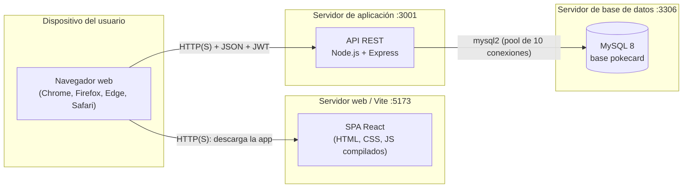
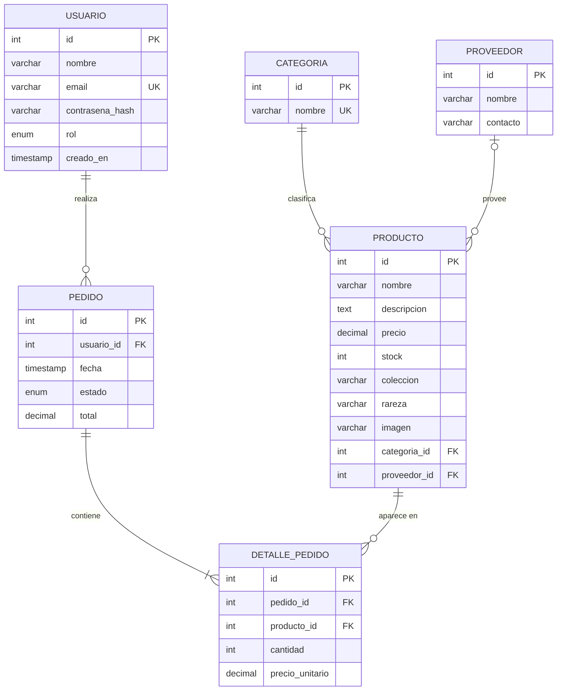
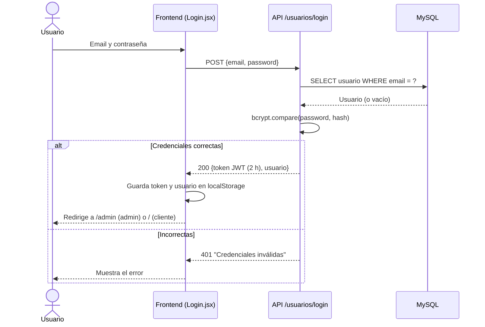
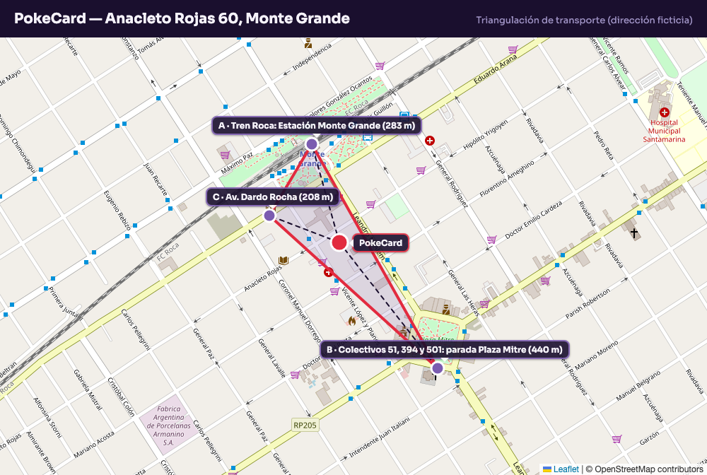
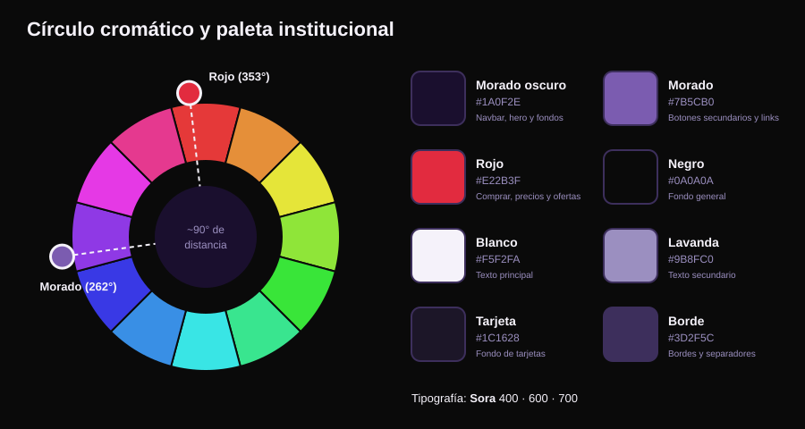
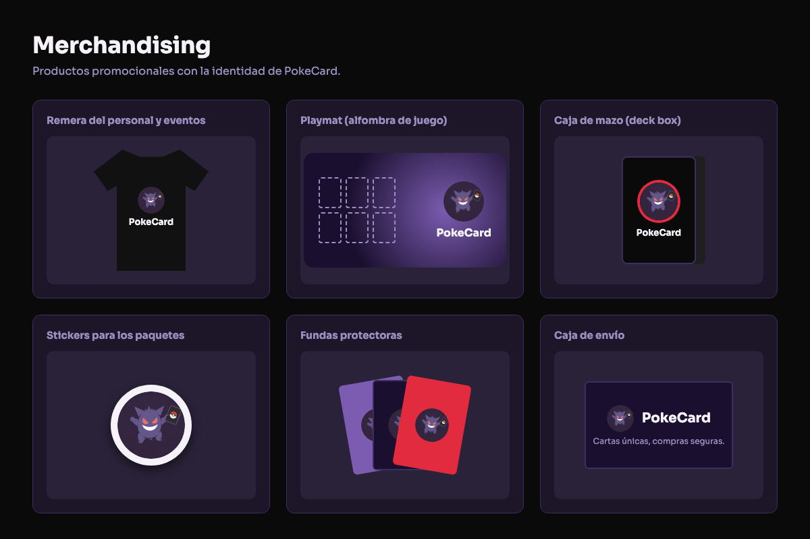
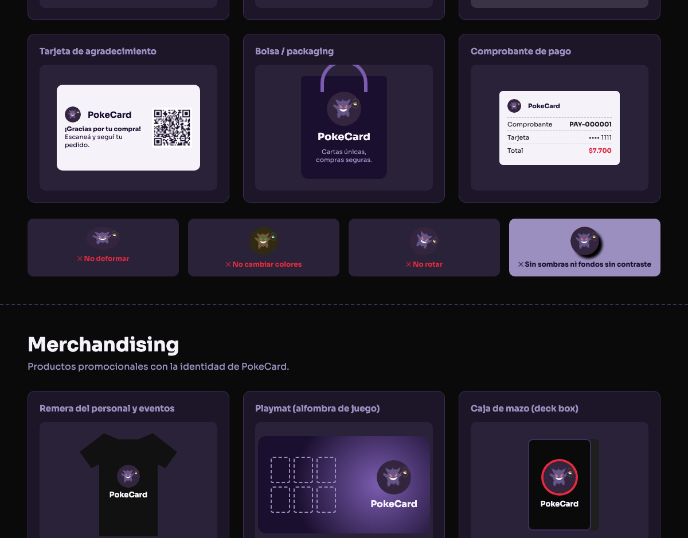
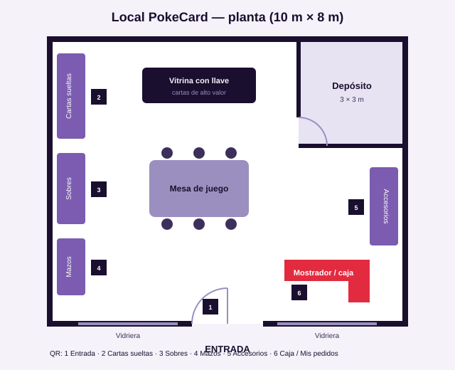
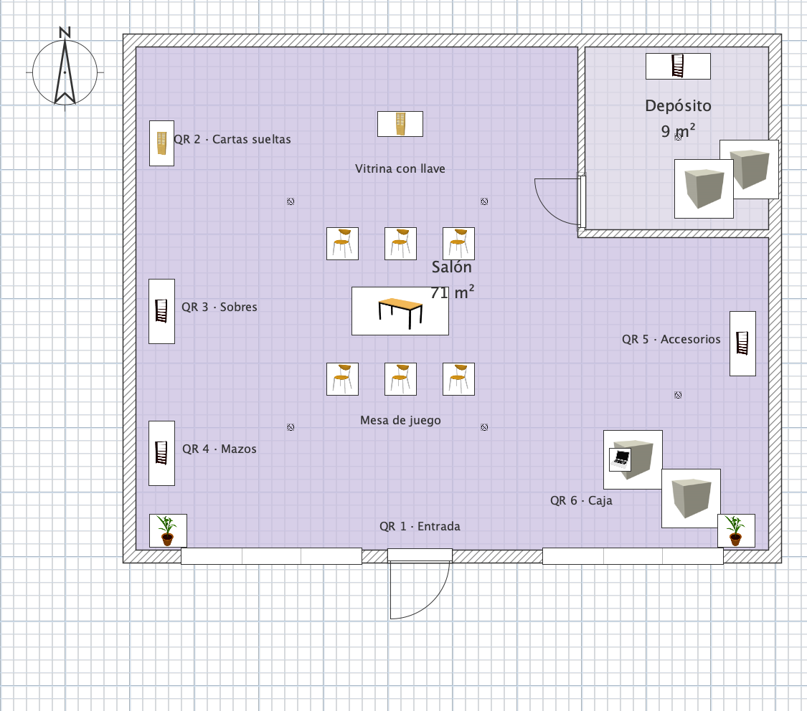
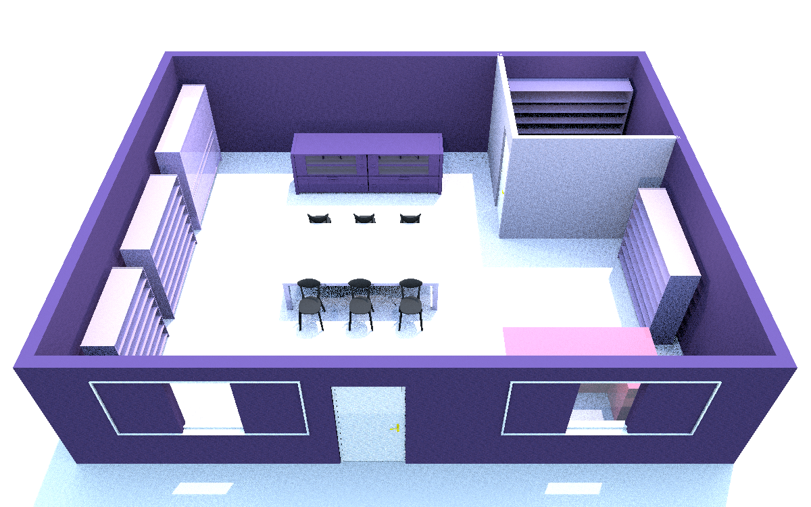

# PokeCard — Documentación técnica

> *"Cartas únicas, compras seguras."*
> Tienda online de cartas coleccionables Pokémon.

## Índice

1. [Introducción](#1-introducción)
2. [Descripción del sistema](#2-descripción-del-sistema)
3. [Arquitectura del sistema](#3-arquitectura-del-sistema)
4. [Diseño de datos](#4-diseño-de-datos)
5. [Comportamiento del sistema](#5-comportamiento-del-sistema)
6. [Restricciones del diseño](#6-restricciones-del-diseño)
7. [Pruebas y validaciones](#7-pruebas-y-validaciones)
8. [Despliegue y operación](#8-despliegue-y-operación)
9. [Ciclo de vida del software](#9-ciclo-de-vida-del-software)
10. [Sector de Marketing e Identidad Institucional](#10-sector-de-marketing-e-identidad-institucional)

---

## 1. Introducción

### 1.1 Descripción general
PokeCard es una aplicación web de comercio electrónico para vender cartas coleccionables Pokémon (cartas sueltas, sobres, mazos y accesorios). Tiene un **frontend** en React + Vite y un **backend** (API REST) en Node.js + Express conectado a una base de datos **MySQL 8**. Hay dos roles: **cliente** (navega el catálogo, compra y consulta sus pedidos) y **admin** (gestiona productos y ve el panel de métricas).

### 1.2 Propósito
Este documento describe cómo está construido PokeCard: su arquitectura, los datos, el comportamiento, las restricciones, las pruebas, el despliegue y la identidad institucional. Sirve como referencia para el equipo de desarrollo, los docentes que evalúan el proyecto y cualquier persona que tenga que mantenerlo en el futuro.

### 1.3 Alcance
**Incluye:** registro e inicio de sesión con roles, catálogo con filtros, detalle de producto, carrito, checkout con **pago simulado**, historial de pedidos del cliente, gestión de pedidos y sus estados por el admin, CRUD de productos, gestión de categorías y proveedores por API y dashboard administrativo.

**No incluye (por ahora):** pasarela de pago real, envíos con seguimiento del correo, recuperación de contraseña ni pantallas de administración de categorías y proveedores (solo existe la API).

### 1.4 Objetivos de la documentación
- Dejar registrado **qué** hace el sistema y **cómo** lo hace, con referencias al código.
- Facilitar que un integrante nuevo pueda instalarlo y entenderlo sin ayuda.
- Justificar las decisiones de diseño (seguridad, datos y arquitectura).
- Unificar en un solo lugar la parte técnica y la identidad institucional de la empresa.

---

## 2. Descripción del sistema

### 2.1 Objetivo del sistema
Que los coleccionistas puedan **comprar cartas con confianza**, encontrándolas rápido por colección, rareza o categoría, y que el administrador controle productos, stock y ventas desde un único panel.

**Problema que resuelve:** quienes coleccionan suelen comprar con desconfianza (no saben si la carta es auténtica) y les cuesta buscar por colección o rareza. PokeCard ofrece un catálogo seleccionado, filtros específicos y el stock y los pedidos guardados en una base de datos.

### 2.2 Stakeholders

| Stakeholder | Interés / rol |
|---|---|
| Clientes (coleccionistas y jugadores) | Buscar cartas, comprar de forma segura y ver sus pedidos. |
| Visitantes | Navegar el catálogo sin cuenta y registrarse. |
| Administrador de la tienda | Gestionar productos, stock, categorías y proveedores; ver métricas. |
| Proveedores (ej. Distribuidora Kanto, Johto Import) | Abastecen los productos; quedan registrados en la tabla `proveedor`. |
| Equipo de desarrollo | Construir, probar y mantener el sistema. |
| Docentes / evaluadores | Evaluar el cumplimiento de los requisitos de cada etapa. |

### 2.3 Funciones principales
Ver el detalle completo en [`Requerimientos.md`](Requerimientos.md).

| Función | Requerimientos |
|---|---|
| Registro, login, logout y control de acceso por rol | RF-01 a RF-04 |
| Catálogo con filtros, orden y búsqueda | RF-05, RF-06 |
| Detalle de producto | RF-07 |
| CRUD de productos | RF-08 a RF-11 |
| Categorías y proveedores (API) | RF-12 |
| Dashboard administrativo | RF-13 |
| Carrito y compra con pago simulado | RF-14 |
| Mis pedidos y gestión de pedidos del admin | RF-15 |

### 2.4 Restricciones generales
- Tecnologías fijadas por el proyecto: **Node.js 18+, Express, MySQL 8, React 18 y Vite 5**.
- El pago es **simulado**: no se conecta a ningún banco ni se guarda el número de tarjeta.
- El frontend y el backend se ejecutan por separado y se comunican solo mediante la API REST (JSON).
- Los secretos se configuran por variables de entorno (`.env`) y nunca se suben al repositorio (`.gitignore`).
- El proyecto es académico y tiene entregas por etapas, con plazos definidos por la materia.

---

## 3. Arquitectura del sistema

### 3.1 Estilo arquitectónico
- **Cliente-servidor en tres capas:** presentación (SPA en React), lógica (API REST en Express) y datos (MySQL).
- **API REST sin estado:** cada petición se autentica con un token **JWT** en el encabezado `Authorization: Bearer <token>`; el servidor no guarda sesiones.
- **Backend organizado por capas:** rutas (`routes/`), middleware (`middleware/auth.js`) y acceso a datos (`db.js` con pool de conexiones).
- **Frontend basado en componentes**, con estado global en Context API (`AuthContext`, `CarritoContext`) y ruteo con React Router.

### 3.2 Componentes principales

| Capa | Componente | Archivo | Responsabilidad |
|---|---|---|---|
| Frontend | Ruteo | `frontend/src/App.jsx` | Define las páginas y protege `/checkout`, `/pedidos` y `/admin`. |
| Frontend | Sesión | `frontend/src/AuthContext.jsx` | Login, registro, logout y token en `localStorage`. |
| Frontend | Carrito | `frontend/src/CarritoContext.jsx` | Productos del carrito, guardados en `localStorage`. |
| Frontend | Cliente HTTP | `frontend/src/api.js` | Llama a la API y agrega el token. |
| Frontend | Ruta protegida | `frontend/src/components/RutaProtegida.jsx` | Redirige si no hay sesión o si el usuario no es admin. |
| Frontend | Validaciones | `frontend/src/validaciones.js` | Luhn, vencimiento y datos del registro (con tests de Vitest). |
| Frontend | Páginas | `frontend/src/pages/` | Home, Login, Registro, Catálogo, Detalle, Carrito, Checkout, Mis pedidos y Admin (Dashboard, Productos, Pedidos). |
| Backend | App | `backend/src/app.js` | Configura Express, CORS, JSON, monta las rutas y maneja los errores generales. |
| Backend | Autenticación | `backend/src/middleware/auth.js` | `verificarToken` (401) y `soloAdmin` (403). |
| Backend | Usuarios | `backend/src/routes/usuarios.js` | Registro con bcrypt, login con JWT (con freno de intentos) y listado. |
| Backend | Productos | `backend/src/routes/productos.js` | Listado con filtros y CRUD. |
| Backend | Catálogos | `backend/src/routes/catalogos.js` | CRUD de categorías y proveedores. |
| Backend | Pedidos | `backend/src/routes/pedidos.js` | Compra con pago simulado en una transacción, detalle y cambio de estado. |
| Backend | Admin | `backend/src/routes/admin.js` | Métricas del dashboard. |
| Datos | Base de datos | `database/schema.sql` | Tablas, claves y restricciones. |

### 3.3 Diagrama de despliegue



En desarrollo los tres nodos corren en la misma máquina (`localhost`). En producción se pueden separar en servidores distintos (ver [8.2](#82-entorno-de-producción)).

### 3.4 Escalabilidad y rendimiento
- **API sin estado (JWT):** permite levantar varias instancias del backend detrás de un balanceador sin compartir sesiones.
- **Pool de conexiones** a MySQL (`connectionLimit: 10`) para reutilizar conexiones en lugar de abrir una por petición.
- **Filtros en la base de datos** (`WHERE ... IN`, `LIKE`) para no traer datos de más al servidor.
- **Frontend estático** compilado con `vite build`: se puede servir desde un CDN o un servidor web común.
- **Mejoras a futuro:** paginación del catálogo, índices en `producto(categoria_id, coleccion, rareza)`, caché de `/productos/filtros` y compresión HTTP.

---

## 4. Diseño de datos

### 4.1 Diagrama Entidad-Relación
Diagramas originales: [`DER_PokeCard.png`](DER_PokeCard.png) y [`Diagrama_BD_PokeCard.png`](Diagrama_BD_PokeCard.png).



### 4.2 Descripción de entidades

| Entidad | Descripción | Atributos clave |
|---|---|---|
| `usuario` | Personas con cuenta en el sistema. | `email` único, `contrasena_hash` (bcrypt), `rol` = `cliente` o `admin`. |
| `categoria` | Tipo de producto: Cartas sueltas, Sobres, Mazos, Accesorios. | `nombre` único. |
| `proveedor` | Empresa que abastece los productos. | `nombre`, `contacto`. |
| `producto` | Carta o artículo a la venta. | `precio`, `stock`, `coleccion`, `rareza`, `categoria_id` (obligatoria), `proveedor_id` (opcional). |
| `pedido` | Compra realizada por un usuario. | `estado` = `pendiente`, `pagado`, `enviado` o `cancelado`; `total`. |
| `detalle_pedido` | Cada línea de un pedido. | `cantidad > 0` y `precio_unitario` (precio del momento de la compra). |

### 4.3 Reglas de integridad
- **Entidad:** todas las tablas tienen clave primaria `id` autoincremental.
- **Unicidad:** `usuario.email` y `categoria.nombre` son `UNIQUE`.
- **Dominio:** `precio >= 0`, `stock >= 0` y `cantidad > 0` (`CHECK`); `rol` y `estado` son `ENUM`.
- **Referencial:**
  - `producto.categoria_id → categoria.id` (obligatoria).
  - `producto.proveedor_id → proveedor.id` (opcional).
  - `pedido.usuario_id → usuario.id`.
  - `detalle_pedido.pedido_id → pedido.id` con `ON DELETE CASCADE` (si se borra el pedido, se borran sus líneas).
  - `detalle_pedido.producto_id → producto.id`: impide borrar un producto que ya se vendió (la API responde **409**).
- **Reglas de negocio en la API:** el rol de un usuario nuevo siempre es `cliente`; el precio y el stock de una compra se leen de la base y nunca del cliente; la compra se hace en una **transacción** con `SELECT ... FOR UPDATE` para que dos compras simultáneas no dejen el stock negativo.

### 4.4 Migración y respaldo
- **Creación:** `mysql -u root -p < database/schema.sql` crea la base `pokecard` (utf8mb4).
- **Datos iniciales:** `npm run seed` carga categorías, proveedores, productos y los usuarios de prueba; si la base ya tiene datos, no hace nada.
- **Migraciones:** cada cambio de estructura se agrega como un script SQL nuevo y numerado (ej. `database/migraciones/001_agregar_imagen.sql`), que se ejecuta en orden y se versiona en Git. No se edita un script que ya se aplicó en producción.
- **Respaldo:**
  ```bash
  mysqldump -u root -p --single-transaction pokecard > respaldo_pokecard_AAAA-MM-DD.sql
  ```
  Se recomienda un respaldo diario automático (cron o Programador de tareas), conservar los últimos 7 y guardar una copia fuera del servidor.
- **Restauración:**
  ```bash
  mysql -u root -p pokecard < respaldo_pokecard_AAAA-MM-DD.sql
  ```

---

## 5. Comportamiento del sistema

### 5.1 Escenarios principales

| # | Actor | Escenario | Resultado |
|---|---|---|---|
| E1 | Visitante | Entra a Home, va al catálogo, filtra por colección/rareza y abre un producto. | Ve el detalle con precio y stock. |
| E2 | Visitante | Se registra con nombre, email y contraseña. | Se crea la cuenta como **cliente** y entra automáticamente. |
| E3 | Cliente | Agrega productos al carrito, va a checkout y paga con una tarjeta de prueba. | Se crea un pedido `pagado`, se descuenta el stock y se muestra el comprobante `PAY-000001`. |
| E4 | Cliente | Paga con una tarjeta terminada en `0002`. | La API responde 402, no se crea el pedido y el stock no cambia. |
| E5 | Cliente | Entra a "Mis pedidos". | Ve sus pedidos con fecha, estado y total. |
| E6 | Admin | Inicia sesión. | Se lo redirige a `/admin` (dashboard con métricas). |
| E7 | Admin | Crea, edita o elimina un producto. | El catálogo se actualiza; si el producto ya se vendió, no se borra (409). |
| E8 | Cliente | Intenta entrar a `/admin`. | Se lo redirige al inicio; la API respondería 403. |
| E9 | Admin | En **Panel admin → Pedidos** ve el detalle de un pedido y lo marca como enviado o lo cancela. | Cambia el estado; si lo cancela, el stock vuelve al inventario. |
| E10 | Cliente | Paga con una tarjeta mal escrita o vencida. | Se muestra el error en el formulario; no se crea el pedido. |

### 5.2 Inicio de sesión



- Mismo mensaje si falla el email o la contraseña (no revela qué cuentas existen).
- El token incluye `id`, `nombre` y `rol` y vence a las **2 horas** (`JWT_EXPIRES`).
- El **logout** borra el token y el usuario de `localStorage`.

### 5.3 Validaciones

| Dónde | Campo | Regla |
|---|---|---|
| Registro | nombre, email, contraseña | Obligatorios; email con formato válido; contraseña de 6 caracteres o más; email no repetido (409). |
| Login | email, contraseña | Obligatorios (400); después de 5 intentos fallidos con el mismo email se bloquea 15 minutos (429). |
| Producto | nombre | Obligatorio. |
| Producto | precio | Número mayor o igual a 0. |
| Producto | stock | Entero mayor o igual a 0. |
| Producto | categoría / proveedor | La categoría es obligatoria; ambos deben existir (400). |
| Catálogo | orden | Solo `precio_asc`, `precio_desc` o `nombre` (lista permitida contra inyección SQL). |
| Pedido | ítems | Carrito no vacío; `producto_id` y `cantidad` enteros, cantidad de 1 o más. |
| Pedido | tarjeta | Solo dígitos, de 13 a 19 y válido según el **algoritmo de Luhn**; titular de 3 caracteres o más; vencimiento `MM/AA` no vencido (vale hasta el último día de ese mes); CVC de 3 o 4 dígitos. Se valida igual en el frontend (`validaciones.js`) y en el backend. |
| Pedido | estado | Solo `pendiente → pagado / cancelado` y `pagado → enviado / cancelado`; los pedidos enviados o cancelados no cambian (409). |
| Pedido | stock | Debe alcanzar para cada producto (409). Si el mismo producto viene repetido en el carrito, se suman las cantidades. |

Las validaciones del frontend son para dar una buena experiencia; las del backend son las que valen, porque el cliente se puede saltear.

### 5.4 Manejo de errores
Todas las respuestas de error son JSON con la forma `{ "error": "mensaje claro" }`.

| Código | Cuándo |
|---|---|
| 400 | Datos inválidos o faltantes, o un JSON mal formado. |
| 401 | Sin token, token inválido o vencido, credenciales incorrectas. |
| 402 | Pago rechazado por el "banco" (simulación). |
| 403 | El usuario no es admin. |
| 404 | Producto o ruta inexistente. |
| 409 | Email o categoría repetidos, stock insuficiente, producto con pedidos asociados, cambio de estado no permitido. |
| 413 | La petición es demasiado grande (más de 100 KB). |
| 429 | Demasiados intentos de login fallidos. |
| 500 | Error inesperado del servidor (se registra con `console.error` y no se muestran detalles internos). Un manejador general en `app.js` atrapa cualquier error no controlado. |

- En la compra, ante cualquier error se hace **rollback** de la transacción: nunca queda un pedido a medias.
- En el frontend, los errores se muestran en pantalla con la clase `.error`; si el token venció, el usuario tiene que volver a iniciar sesión.
- Si falta `JWT_SECRET`, el servidor no arranca y lo informa por consola.

---

## 6. Restricciones del diseño

### 6.1 Compatibilidad
- Navegadores: versiones actuales de **Chrome, Firefox, Edge y Safari** (RNF-12).
- Diseño **responsive** para celular, tablet y computadora (RNF-08).
- Servidor: **Node.js 18+** y **MySQL 8** en Windows, macOS o Linux (RNF-11).

### 6.2 Rendimiento
- El catálogo responde en **menos de 1 segundo** con hasta 1.000 productos (RNF-09).
- Pool de 10 conexiones a MySQL.
- El frontend se compila y minifica para producción con `vite build`.

### 6.3 Seguridad
- Contraseñas con **bcrypt** (10 rondas de sal); nunca se devuelve el hash (RNF-01).
- **JWT** firmado con vencimiento de 2 h (RNF-02).
- Rutas de administración protegidas por rol: 401 / 403 (RNF-03).
- Consultas **parametrizadas** y orden con lista permitida contra inyección SQL (RNF-04).
- Mensaje de login genérico (RNF-05).
- Secretos en `.env`, fuera del repositorio (RNF-06).
- El número completo de la tarjeta **no se guarda**: solo se devuelven los últimos 4 dígitos.
- Los precios se toman siempre de la base de datos, no del cliente.
- Freno contra **fuerza bruta** en el login: 5 intentos fallidos por email cada 15 minutos (429).
- **CORS configurable** con `CORS_ORIGIN` para aceptar solo el dominio del frontend en producción.
- Límite de 100 KB por petición y sin el encabezado `X-Powered-By` (no se revela la tecnología del servidor).
- Un cliente solo puede ver sus propios pedidos; si pide uno ajeno, la API responde 404 para no revelar que existe.

### 6.4 Normativas aplicables
- **Ley 25.326 de Protección de Datos Personales (Argentina):** se piden solo los datos necesarios (nombre y email), las contraseñas se guardan encriptadas y el usuario puede pedir que se borren sus datos.
- **Ley 24.240 de Defensa del Consumidor** y normativa de comercio electrónico: mostrar precio final, información clara del producto y la posibilidad de arrepentirse de la compra ("botón de arrepentimiento").
- **Ley 11.723 de Propiedad Intelectual** y marcas: "Pokémon", sus personajes y la Pokébola son marcas de sus dueños. PokeCard es un revendedor: no usa los logotipos oficiales de la franquicia, pero su isotipo es una ilustración de Gengar con una carta. Para un uso comercial real, el isotipo tendría que reemplazarse por un personaje original o contar con licencia. Por eso el tríptico incluye la leyenda de marcas.
- **PCI DSS** (referencia): al ser un pago simulado no se procesan tarjetas reales; si se integra un pago real, se debe usar una pasarela certificada (ej. Mercado Pago) y nunca guardar los datos de la tarjeta.
- **WCAG 2.1** (recomendación de accesibilidad): contraste suficiente, textos alternativos y formularios con etiquetas.

### 6.5 Limitaciones tecnológicas
- El pago es una **simulación**; no hay pasarela real.
- El token se guarda en `localStorage`, que es vulnerable si el sitio sufriera un ataque XSS (una mejora sería usar cookies `httpOnly`).
- No hay recuperación de contraseña ni verificación de email.
- El carrito vive en el navegador: no se sincroniza entre dispositivos.
- Las imágenes de los productos se guardan como URL; no hay subida de archivos.
- Categorías y proveedores se gestionan solo por API (sin pantalla).
- El freno de intentos de login se guarda en memoria: se reinicia si se reinicia el servidor y no se comparte entre varias instancias.
- Si no se configura `CORS_ORIGIN`, la API acepta peticiones de cualquier origen (pensado solo para desarrollo).

---

## 7. Pruebas y validaciones

### 7.1 Pruebas unitarias
Herramientas: **Jest** + **Supertest**. La base de datos se reemplaza por un **mock** (`backend/tests/setup.js`), así que no hace falta MySQL.

```bash
cd backend
npm test
```

| Archivo | Casos |
|---|---|
| `usuarios.test.js` (8) | Guarda el hash y fuerza el rol cliente; email repetido (409); contraseña corta (400); login correcto devuelve un JWT válido; contraseña incorrecta (401); bloqueo después de 5 intentos (429); JSON mal formado (400); ruta inexistente (404). |
| `permisos.test.js` (5) | Sin token (401); token inválido (401); cliente no crea productos (403); cliente no ve el dashboard (403); admin crea un producto (201). |
| `productos.test.js` (8) | Listado; producto inexistente (404); orden con lista permitida; precio negativo (400); editar inexistente (404); eliminar con pedidos (409); métricas del dashboard; categoría repetida (409). |
| `pedidos.test.js` (16) | Compra: sin token (401); carrito vacío (400); tarjeta que no cumple Luhn (400); tarjeta vencida (400); stock insuficiente (409); producto repetido en el carrito; tarjeta rechazada (402); pago aprobado con total correcto y sin el número completo. Gestión: el cliente no ve todos los pedidos (403); el admin sí; un pedido ajeno da 404; el dueño ve el detalle; el cliente no cambia estados (403); estado inexistente (400); un enviado no se cancela (409); cancelar devuelve el stock. |

**Total backend: 37 tests.**

### 7.2 Pruebas de integración
Los tests con Supertest ya prueban la integración **rutas + middleware + validaciones** sobre la app de Express real. Para probar contra MySQL real:

| # | Prueba | Pasos | Resultado esperado |
|---|---|---|---|
| I1 | Base y seed | `schema.sql` y `npm run seed` | Se crean 6 tablas, 9 productos y 2 usuarios. |
| I2 | Login real | `POST /usuarios/login` con el admin de prueba | 200 con token. |
| I3 | Compra completa | Login como cliente y `POST /pedidos` con `4111 1111 1111 1111` | 201; aparece en `pedido` y `detalle_pedido`; baja el stock. |
| I4 | Concurrencia de stock | Dos compras al mismo tiempo de un producto con stock 1 | Una da 201 y la otra 409; el stock queda en 0. |
| I5 | Integridad | Borrar un producto que ya se vendió | 409; el producto sigue existiendo. |
| I7 | Cancelación | `PATCH /pedidos/:id/estado` con `cancelado` sobre un pedido pagado | El pedido queda cancelado y el stock de sus productos vuelve a sumar. |
| I6 | Front + API | Levantar ambos y comprar desde la interfaz | El pedido aparece en "Mis pedidos" y en el dashboard. |

### 7.3 Pruebas de funcionalidades web

| # | Funcionalidad | Pasos | Resultado esperado |
|---|---|---|---|
| W1 | Registro | Completar el formulario con datos válidos | Entra logueado como cliente. |
| W2 | Login incorrecto | Contraseña errónea | Mensaje "Credenciales inválidas". |
| W3 | Filtros | Filtrar por rareza "Rara Holo" y ordenar por precio | Solo productos holo, ordenados. |
| W4 | Búsqueda | Buscar "Fuego" | Aparece "Carta Holo Fuego". |
| W5 | Carrito | Agregar 2 productos, recargar la página | El carrito se mantiene (se lee de `localStorage` al iniciar). Cada usuario tiene su propio carrito. |
| W6 | Checkout sin sesión | Ir a `/checkout` sin login | Redirige a `/login`. |
| W7 | Pago rechazado | Tarjeta válida terminada en `0002` | Mensaje de rechazo; no se crea pedido. |
| W8 | Acceso admin | Cliente entra a `/admin` | Redirige al inicio. |
| W9 | CRUD | Admin crea, edita y elimina un producto | Los cambios se ven en el catálogo. |
| W10 | Logout | Cerrar sesión | Desaparece el menú de usuario y `/pedidos` redirige al login. |
| W11 | Tarjeta inválida | Pagar con `1234 5678 9012 3456` o con vencimiento `01/20` | El formulario marca el error; no se crea pedido. |
| W12 | Gestión de pedidos | Admin → **Pedidos** → **Ver**, **Marcar enviado** o **Cancelar** | Se ve el detalle y cambia el estado; al cancelar, el stock vuelve. |

### 7.4 Pruebas del frontend

| # | Aspecto | Cómo se prueba | Esperado |
|---|---|---|---|
| F1 | Responsive | DevTools en 375 px, 768 px y 1280 px | Sin scroll horizontal; el navbar y las grillas se acomodan. |
| F2 | Identidad visual | Comparar con la paleta de [10.6](#106-círculo-cromático-y-paleta-institucional) | Colores y tipografía **Sora** correctos en todas las páginas. |
| F3 | Navegación | Recorrer todos los links del navbar | Ningún link roto; la ruta inexistente muestra "Página no encontrada". |
| F4 | Formularios | Enviar campos vacíos | El navegador marca los campos `required`; se muestran errores claros. |
| F5 | Tarjeta animada | Escribir datos en el checkout | La tarjeta de `crd-ui` se actualiza y se da vuelta en el CVC. |
| F6 | Compatibilidad | Probar en Chrome, Firefox, Edge y Safari | Mismo comportamiento. |
| F7 | Accesibilidad | Lighthouse (pestaña Accesibilidad) | Puntaje de 90 o más; imágenes con `alt`. |
| F8 | Rendimiento | Lighthouse (Rendimiento) sobre `vite build` | Puntaje de 80 o más. |

**Tests automáticos del frontend (Vitest):** `frontend/src/__tests__/validaciones.test.js`, con **12 tests** de las validaciones del checkout y del registro: Luhn, vencimiento (mes actual, mes pasado, mes 13 y formato), errores por campo y datos del registro.

```bash
cd frontend
npm test
```

*Mejora futura:* tests de componentes con React Testing Library.

### 7.5 Criterios de aceptación
- Los **37 tests** del backend y los **12** del frontend pasan (`npm test` en cada carpeta), y `npm run build` del frontend compila sin errores.
- Todos los RF marcados como "Hecho" en `Requerimientos.md` se pueden demostrar en la interfaz.
- Ninguna contraseña se ve en texto plano en la base ni en las respuestas de la API.
- Un cliente no puede acceder a ninguna función de admin (ni por la interfaz ni por la API).
- Una compra aprobada crea el pedido y descuenta el stock; una rechazada, con tarjeta inválida o vencida, no cambia nada.
- Cancelar un pedido devuelve el stock.
- La interfaz respeta la identidad visual y funciona en celular.
- Las pruebas W1–W10 y F1–F6 dan el resultado esperado.

---

## 8. Despliegue y operación

### 8.1 Entorno de desarrollo

| Herramienta | Versión |
|---|---|
| Node.js | 18 o superior |
| MySQL | 8 |
| Editor | Visual Studio Code |
| Control de versiones | Git + GitHub |
| Frontend | Vite 5 (`npm run dev` → `http://localhost:5173`) |
| Backend | `node --watch` (`npm run dev` → `http://localhost:3001`) |

Los pasos de instalación están en el [`README.md`](../README.md#cómo-ejecutarlo). Variables del backend (`backend/.env`): `PORT`, `DB_HOST`, `DB_PORT`, `DB_USER`, `DB_PASSWORD`, `DB_NAME`, `JWT_SECRET`, `JWT_EXPIRES`, `CORS_ORIGIN`. Variable del frontend (`frontend/.env`): `VITE_API_URL`.

### 8.2 Entorno de producción
Propuesta:
- **Base de datos:** MySQL 8 administrado (ej. Railway, Aiven o un VPS), con usuario propio de la app (no `root`) y solo los permisos necesarios.
- **Backend:** Node.js en un servicio como Render o Railway, o en un VPS con **PM2**, ejecutado con `npm start`.
- **Frontend:** `npm run build` genera `frontend/dist/`, que se publica en Netlify, Vercel o detrás de Nginx.
- **HTTPS** obligatorio, `JWT_SECRET` largo y aleatorio, y `CORS_ORIGIN=https://pokecard.com.ar` para limitar la API al dominio del frontend.

### 8.3 Publicación del sistema
1. Hacer merge de los cambios a `main` mediante un Pull Request revisado.
2. Correr `npm test` en `backend/` y en `frontend/` (no se publica si falla algún test).
3. Aplicar en la base de producción las migraciones SQL nuevas (después de un respaldo).
4. Publicar el backend y configurar sus variables de entorno.
5. Configurar `VITE_API_URL` con la URL pública de la API y correr `npm run build`.
6. Publicar `frontend/dist/`.
7. Prueba rápida: login, catálogo y una compra con la tarjeta de prueba.
8. Etiquetar la versión en Git (ej. `v1.1.0`).

### 8.4 Monitoreo
- `GET /` devuelve `{ "api": "PokeCard", "estado": "ok" }` y sirve como **chequeo de salud** (ej. con UptimeRobot cada 5 minutos).
- Logs del servidor (`console.error`) revisados desde el panel del hosting o con `pm2 logs`.
- Dashboard de admin: ventas, pedidos y **productos con stock bajo** (5 unidades o menos).
- A futuro: registro de peticiones con `morgan` y alertas por errores 500.

### 8.5 Mantenimiento
- **Correctivo:** los errores se cargan como *issues* en GitHub y se arreglan en una rama propia con su PR.
- **Preventivo:** actualizar dependencias (`npm outdated`, `npm audit`) y verificar los respaldos.
- **Evolutivo:** próximas funciones:
  - aviso por email cuando cambia el estado de un pedido;
  - pantallas de categorías y proveedores;
  - recuperación de contraseña;
  - pasarela de pago real.
- Toda mejora mantiene la cobertura de tests y actualiza esta documentación y `Requerimientos.md`.

---

## 9. Ciclo de vida del software

Se usa un modelo **iterativo e incremental por etapas**: en cada entrega se analiza, diseña, desarrolla y prueba una parte del sistema.

| Etapa | Contenido |
|---|---|
| Primera etapa | Identidad, mockups, base de datos, login con roles, CRUD de productos y dashboard. |
| Segunda etapa | Carrito, checkout y pago simulado, mis pedidos. |
| Próximas | Gestión de pedidos del admin, mejoras de administración y despliegue. |

### 9.1 Análisis de requisitos
- **Relevamiento:** se analizó cómo compran los coleccionistas y sus problemas (desconfianza sobre la autenticidad y dificultad para buscar por colección o rareza).
- **Usuarios identificados:** visitante, cliente y admin (ver [2.2](#22-stakeholders)).
- **Resultado:** 15 requerimientos funcionales y 13 no funcionales, priorizados y con su estado, en [`Requerimientos.md`](Requerimientos.md).
- **Validación:** los requerimientos se revisan con el docente al inicio de cada etapa.

### 9.2 Diseño
- **Interfaz:** mockups de Home, Login, Registro, Catálogo, Detalle y Carrito en [`mockups/`](mockups/), siguiendo la identidad visual.
- **Datos:** DER y diagrama de base de datos (ver [sección 4](#4-diseño-de-datos)) y `schema.sql`.
- **Arquitectura:** tres capas y API REST con JWT (ver [sección 3](#3-arquitectura-del-sistema)).
- **API:** tabla de endpoints con su nivel de acceso en el [`README.md`](../README.md#endpoints).
- **Seguridad:** decisiones de bcrypt, JWT, roles y consultas parametrizadas definidas desde el diseño (ver [6.3](#63-seguridad)).

---

## 10. Sector de Marketing e Identidad Institucional

### 10.1 Identidad general de la empresa

| | |
|---|---|
| **Nombre** | PokeCard |
| **Slogan** | *"Cartas únicas, compras seguras."* |
| **Rubro** | Venta online de cartas coleccionables Pokémon, sobres, mazos y accesorios. |
| **Público** | Coleccionistas y jugadores de la franquicia Pokémon, de 12 a 40 años. |
| **Diferencial** | Productos seleccionados y autenticidad verificada. |
| **Misión** | Que cualquier coleccionista consiga la carta que busca con la tranquilidad de una compra segura. |
| **Visión** | Ser la tienda de referencia en cartas Pokémon del país. |
| **Valores** | Confianza, transparencia, pasión por el coleccionismo y atención cercana. |
| **Personalidad de marca** | Misteriosa y divertida, inspirada en el "morado Gengar" (tipo Fantasma). |

### 10.2 Lugar físico de la empresa
PokeCard es principalmente una tienda **online**, con un local de 10 × 8 m para atención, retiro de pedidos y eventos de juego (ver el plano en [10.14](#1014-maquetado-físico--sweet-home-3d)).

| | |
|---|---|
| **Dirección** | Anacleto Rojas 60, Monte Grande (CP 1842), partido de Esteban Echeverría, provincia de Buenos Aires *(dirección ficticia, para el proyecto)* |
| **Horario del local** | Lunes a viernes de 10 a 19 h; sábados de 10 a 14 h |
| **Tienda online** | Todos los días, en `pokecard.com.ar` (dominio propuesto) |
| **Email** | `contacto@pokecard.com.ar` |
| **Redes sociales** | `@pokecard` (Instagram y TikTok) |

### 10.3 Triangulación de medios de transporte y ubicación
El local está en el centro de Monte Grande, dentro del triángulo que forman tres puntos de acceso. Así se llega en tren, en colectivo o en auto, y siempre a menos de 6 cuadras caminando.



| Vértice | Medio | Referencia | Distancia a pie |
|---|---|---|---|
| A | Tren | **Estación Monte Grande**, línea **Roca** (ramal Constitución – Ezeiza) | 283 m (≈ 4 min) |
| B | Colectivo | Parada **Plaza Mitre**: líneas **51, 394 y 501** | 440 m (≈ 6 min) |
| C | Avenida principal | **Av. Dardo Rocha** (acceso en auto y estacionamiento) | 208 m (≈ 3 min) |

- Las ubicaciones y las distancias salen de OpenStreetMap. Las líneas de colectivo son las que figuran como habituales en la zona, así que conviene confirmarlas en una app de transporte.
- El mapa se genera desde [`marketing/triangulacion.html`](marketing/triangulacion.html) (Leaflet + OpenStreetMap).

### 10.4 Isotipo
El **isotipo** es el símbolo de la marca sin texto: la ilustración circular de [`frontend/public/logo.png`](../frontend/public/logo.png), un Gengar sonriente que sostiene una carta sobre fondo morado oscuro. Se usa como favicon y en el navbar (40 × 40 px, recortado en círculo).
- Funciona solo, en tamaños chicos (favicon, perfil de redes sociales, sticker).
- Tamaño mínimo recomendado: 24 px en pantalla y 1 cm impreso.
- Ver la nota de propiedad intelectual en [6.4](#64-normativas-aplicables).

### 10.5 Logotipo
El **logotipo** es el nombre **"PokeCard"** escrito en tipografía **Sora Bold (700)**. Así aparece en el navbar (`.marca`) y en el panel de login.
- **Isologotipo:** isotipo a la izquierda y la palabra "PokeCard" a la derecha, separados por un espacio igual a la mitad del alto del isotipo.
- Versiones: blanco sobre morado oscuro (principal) y morado oscuro sobre blanco (fondos claros).
- **No se debe:** deformar, rotar, cambiar los colores, agregar sombras ni ponerlo sobre fondos que no tengan contraste (ejemplos en [10.9](#109-diversas-aplicaciones-del-logo)).

### 10.6 Círculo cromático y paleta institucional



La paleta parte del **morado** (color principal, "morado Gengar", tono de ~262°) y lo combina con el **rojo** (~353°) para llamar la atención en botones de compra y precios. En el círculo cromático quedan a unos **90° de distancia**: no son complementarios (estarían a 180°), sino una combinación en escuadra que contrasta sin chocar. El morado oscuro y el negro dan profundidad, el lavanda suaviza los textos secundarios y el blanco da legibilidad.

Paleta implementada en el sitio (`frontend/src/styles.css`):

| Color | Código | Variable CSS | Uso |
|---|---|---|---|
| Morado oscuro | `#1A0F2E` | `--morado-oscuro` | Navbar, hero y fondos principales. |
| Morado | `#7B5CB0` | `--morado` | Botones secundarios, links y detalles. |
| Rojo | `#E22B3F` | `--rojo` | Botones de compra, precios y ofertas. |
| Negro | `#0A0A0A` | `--negro` | Fondo general. |
| Blanco | `#F5F2FA` | `--blanco` | Texto principal. |
| Lavanda | `#9B8FC0` | `--lavanda` | Texto secundario. |
| Tarjeta | `#1C1628` | `--tarjeta` | Fondo de tarjetas de producto. |
| Borde | `#3D2F5C` | `--borde` | Bordes y separadores. |

**Tipografía institucional:** **Sora** (Google Fonts), pesos 400 (texto), 600 (destacados) y 700 (títulos y logotipo).

> La propuesta de la primera etapa (`Primera_etapa_original.docx`) usaba tonos más claros de la misma familia (`#241539`, `#5B3E8C`, `#C8283A`, `#121212`, `#FFFFFF`, `#C9BFE0`). En el sitio se ajustaron para el modo oscuro y la paleta oficial es la de la tabla de arriba.

### 10.7 Productos

| Categoría | Ejemplos | Precio de referencia |
|---|---|---|
| Cartas sueltas | Cartas holográficas Base Set (Fuego, Agua, Planta, Eléctrica, Psíquica, Sombra) | $2.800 a $9.900 |
| Sobres | Sobre Booster sellado de 10 cartas | $3.200 |
| Mazos | Mazo inicial de 60 cartas listo para jugar | $15.000 |
| Accesorios | Fundas protectoras x50 | $2.500 |

Los productos se filtran por **colección** (ej. Base Set) y **rareza** (Común, Rara Holo, etc.). Los datos de ejemplo están en `backend/src/seed.js`.

### 10.8 Merchandising



Productos promocionales con la identidad de PokeCard (para regalar con compras grandes o vender aparte):
- **Remera** negra con el isologotipo para el personal y los eventos.
- **Playmat** (alfombra de juego) en degradé morado con zonas para las cartas y el isologotipo.
- **Caja de mazo (deck box)** negra con el isotipo enmarcado en rojo.
- **Stickers** circulares del isotipo para cerrar los paquetes.
- **Fundas protectoras** en morado, morado oscuro y rojo con el isotipo.
- **Caja de envío** en morado oscuro con el isologotipo y el slogan.
- **Tarjeta de agradecimiento** en cada pedido, con un QR a "Mis pedidos" (ver [10.9](#109-diversas-aplicaciones-del-logo)).

Las láminas se generan desde [`marketing/identidad.html`](marketing/identidad.html), que usa la paleta y la tipografía institucionales.

### 10.9 Diversas aplicaciones del logo



| Aplicación | Versión del logo |
|---|---|
| Favicon del sitio | Isotipo |
| Navbar y login del sitio | Isologotipo blanco sobre morado oscuro |
| Redes sociales (foto de perfil) | Isotipo con borde rojo |
| Cartelería del local | Isologotipo grande sobre morado oscuro, con marco rojo |
| Tarjeta de agradecimiento | Isologotipo y QR sobre blanco |
| Bolsa y packaging | Isotipo, logotipo y slogan |
| Comprobante de pago | Isologotipo y número `PAY-xxxxxx` |
| Merchandising | Isotipo o isologotipo (ver [10.8](#108-merchandising)) |

La última fila de la lámina muestra los **usos prohibidos**: deformar, cambiar los colores, rotar, y agregar sombras o usar fondos sin contraste.

### 10.10 Estudio de identidad visual
- **Concepto:** el morado y el personaje tipo Fantasma hacen referencia al coleccionismo misterioso y nocturno; el rojo transmite energía y acción (comprar). El resultado es una marca juvenil pero confiable.
- **Público:** se eligió un estilo oscuro y moderno, cercano a la estética gamer, que conecta con jugadores y coleccionistas.
- **Tipografía:** Sora es geométrica, moderna y muy legible en pantalla; con un único tipo de letra en varios pesos se logra unidad.
- **Color:** paleta reducida de morados con un único acento rojo reservado para las acciones (ver [10.6](#106-círculo-cromático-y-paleta-institucional)).
- **Contraste:** el blanco `#F5F2FA` sobre el negro `#0A0A0A` y sobre el morado oscuro `#1A0F2E` supera la relación 4.5:1 que pide WCAG para texto normal.
- **Formas:** bordes redondeados (8 px en botones, 12 px en paneles, 18 px en el hero) que transmiten cercanía; el isotipo circular funciona bien como avatar, sticker y favicon.
- **Competencia:** las tiendas del rubro suelen tener diseños recargados o genéricos; PokeCard se diferencia con una paleta reducida y consistente.
- **Punto a mejorar:** el isotipo usa un personaje de la franquicia. Para una marca comercial propia conviene diseñar una mascota original con el mismo estilo (ver [6.4](#64-normativas-aplicables)).

### 10.11 Manual de identidad / manual de usuario

**Manual de identidad (resumen)**
1. Usar solo los colores de la [paleta institucional](#106-círculo-cromático-y-paleta-institucional).
2. Usar solo la tipografía Sora (400, 600 y 700).
3. Respetar el área de protección del logo: un margen igual al alto de la letra "P" alrededor del logotipo.
4. Respetar el tamaño mínimo del isotipo (24 px o 1 cm).
5. No deformar, rotar ni cambiar los colores del logo (ver los usos prohibidos en [10.9](#109-diversas-aplicaciones-del-logo)).
6. El rojo se reserva para las acciones principales (comprar, pagar, ofertas).

**Manual de usuario (resumen)**

| Quiero... | Cómo |
|---|---|
| Crear una cuenta | Hacer clic en **Registrate**, completar nombre, email y contraseña (6 caracteres o más). |
| Iniciar sesión | Ir a **Ingresar** y escribir el email y la contraseña. |
| Buscar una carta | Ir a **Catálogo**, usar el buscador o los filtros de categoría, colección y rareza. |
| Comprar | Abrir el producto, **Agregar al carrito**, ir al **Carrito** y luego a **Finalizar compra**; completar la tarjeta y confirmar. |
| Ver mis compras | Menú **Mis pedidos**. |
| (Admin) Ver métricas | Iniciar sesión como admin y entrar a **Panel admin**. |
| (Admin) Cargar un producto | **Panel admin → Productos → + Nuevo producto**, completar los datos y guardar. |
| (Admin) Gestionar pedidos | **Panel admin → Pedidos**: filtrar por estado, **Ver** el detalle, **Marcar enviado** o **Cancelar** (devuelve el stock). |

### 10.12 Tríptico informativo
Folleto A4 apaisado, plegado en tres cuerpos, con la paleta y la tipografía institucionales.

- **Para imprimir:** [`marketing/triptico.pdf`](marketing/triptico.pdf) (2 páginas: exterior e interior).
- **Fuente editable:** [`marketing/triptico.html`](marketing/triptico.html). Se abre en Chrome y se exporta con *Imprimir → Guardar como PDF*, en A4 horizontal y sin márgenes.

| Cara | Cuerpo izquierdo | Cuerpo central | Cuerpo derecho (tapa) |
|---|---|---|---|
| **Exterior** | Contacto: dirección, horarios y email. | QR a la tienda y plano del local con los QR de cada sector. | Isotipo, nombre, slogan y sello "Autenticidad verificada". |
| **Interior** | ¿Quiénes somos?: misión, visión y valores. | Productos con precios y filtros para coleccionistas. | ¿Cómo comprar? en 4 pasos y garantía de autenticidad. |

Si cambia algún dato, se edita el HTML y se vuelve a exportar el PDF.

### 10.13 Códigos QR de los sectores
Cada sector del local (y el tríptico) tiene un QR que lleva a la sección correspondiente del sitio. Están en [`marketing/qr/`](marketing/qr/), en SVG (para imprimir en cualquier tamaño) y PNG, en morado oscuro `#1A0F2E` sobre blanco, con corrección de errores alta.

| N.º | Sector | Destino | Archivo |
|---|---|---|---|
| 1 | Entrada | `https://pokecard.com.ar/` | `qr_1_entrada` |
| 2 | Exhibidor de cartas sueltas | `https://pokecard.com.ar/catalogo?categoria=1` | `qr_2_cartas_sueltas` |
| 3 | Exhibidor de sobres | `https://pokecard.com.ar/catalogo?categoria=2` | `qr_3_sobres` |
| 4 | Exhibidor de mazos | `https://pokecard.com.ar/catalogo?categoria=3` | `qr_4_mazos` |
| 5 | Accesorios | `https://pokecard.com.ar/catalogo?categoria=4` | `qr_5_accesorios` |
| 6 | Caja / atención | `https://pokecard.com.ar/pedidos` (Mis pedidos) | `qr_6_caja_mis_pedidos` |

<p>


</p>

El catálogo ya lee el parámetro `?categoria=` y abre filtrado. `pokecard.com.ar` es el **dominio propuesto**: al momento de generar los QR no tenía registros DNS. Si el sitio se publica en otro dominio, los QR se regeneran con:

```bash
npx qrcode@1.5.4 -t svg -e H -d 1A0F2E -l FFFFFF -o qr_1_entrada.svg "https://<dominio>/"
```

### 10.14 Maquetado físico — Sweet Home 3D



Plano de referencia del local (10 × 8 m) para armar el modelo en **Sweet Home 3D**. Los números negros marcan dónde va el QR de cada sector ([10.13](#1013-códigos-qr-de-los-sectores)).

| Sector | Ubicación y medidas | Mobiliario sugerido (catálogo de Sweet Home 3D) |
|---|---|---|
| Entrada | Pared de abajo, puerta de 1 m al centro, vidrieras a los lados | Puerta, ventanas de vidriera, cartel con el isologotipo |
| Cartas sueltas | Pared izquierda, exhibidor de 2,4 m | Estantería / vitrina |
| Vitrina con llave | Centro arriba, 3,2 × 1 m | Vitrina de vidrio (cartas de alto valor) |
| Sobres | Pared izquierda, 2 m | Estantería |
| Mazos | Pared izquierda, 1,6 m | Estantería |
| Mesa de juego | Centro, 2,8 × 1,6 m, 6 sillas | Mesa y sillas |
| Accesorios | Pared derecha, 2,2 m | Estantería |
| Mostrador / caja | Abajo a la derecha, en L | Mostrador, caja registradora, computadora |
| Depósito | Arriba a la derecha, 3 × 3 m, con puerta | Estanterías metálicas, cajas |

**Modelo en Sweet Home 3D:** [`marketing/local_pokecard.sh3d`](marketing/local_pokecard.sh3d) se abre con Sweet Home 3D 7.6 o superior (*Archivo → Abrir*).

| Vista 2D (plano del programa) | Vista 3D aérea |
|---|---|
|  |  |

Contenido del modelo:
- **Paredes:** 6 (las exteriores en morado oscuro `#1A0F2E` y las del depósito en lavanda `#9B8FC0`).
- **Ambientes:** 2, el salón (71 m²) y el depósito (9 m²).
- **Muebles:** 30 del catálogo del programa, más 6 luces de techo:
  - aberturas: puerta de entrada, 2 vidrieras y puerta del depósito;
  - exhibidores, vitrina con llave, mesa de juego con 6 sillas;
  - mostrador rojo `#E22B3F` con la computadora de la caja;
  - estantería y cajas del depósito, y plantas.
- **Carteles:** 8, entre ellos los **QR 1 a 6** en el mismo lugar que el plano y el punto 10.13.

El modelo se generó con la librería de Sweet Home 3D a partir de [`marketing/sweethome3d/GenerarLocal.java`](marketing/sweethome3d/GenerarLocal.java), así que se puede regenerar o editar a mano en el programa. Para cambiar algo (un mueble, un color) alcanza con abrir el `.sh3d`, modificarlo y guardarlo.

### 10.16 Integración del sector
La identidad institucional no es una parte aparte: está aplicada en el sistema.
- La **paleta** y la **tipografía** de [10.6](#106-círculo-cromático-y-paleta-institucional) son las variables CSS de `frontend/src/styles.css` y la fuente Sora cargada en `frontend/index.html`. El tríptico y las láminas usan las mismas variables.
- El **isotipo** es el favicon y el logo del navbar (`frontend/public/logo.png`).
- El **slogan** aparece en el título de la página, en el panel de login y registro, y en el tríptico.
- Los **productos** de [10.7](#107-productos) son los del catálogo (`seed.js`) y los mismos del tríptico.
- Los **QR** de [10.13](#1013-códigos-qr-de-los-sectores) llevan a las rutas reales del sitio (`/catalogo?categoria=`, `/pedidos`), y el plano del local indica dónde va cada uno.
- El **comprobante** `PAY-xxxxxx` que genera la API es el mismo de la lámina de aplicaciones del logo.
- El **tríptico**, el **merchandising** y el **local en Sweet Home 3D** (`local_pokecard.sh3d`) usan la misma paleta, para que la experiencia sea igual en el local y en la web.
- La prueba **F2** ([7.4](#74-pruebas-del-frontend)) verifica que el sitio respete esta identidad.
